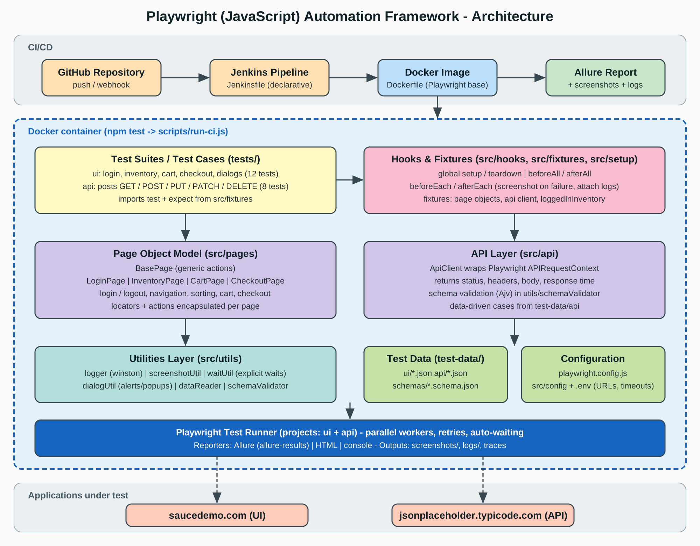
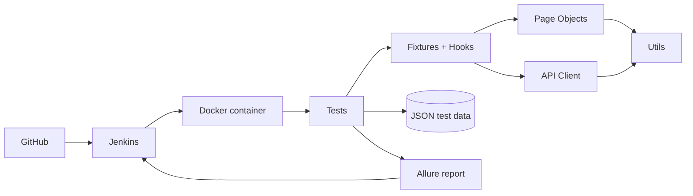

# Framework Architecture

## Layers (top to bottom)

| Layer | Folder | Responsibility |
|---|---|---|
| Test suites / test cases | `tests/ui`, `tests/api` | Only test logic and assertions. No locators, no raw HTTP calls. |
| Hooks & fixtures | `src/hooks`, `src/fixtures`, `src/setup` | Setup/teardown, dependency injection of page objects and the API client, screenshot on failure, log attachment. |
| Page Object Model | `src/pages` | One class per page holding its locators and actions; `BasePage` holds generic actions shared by all pages. |
| API layer | `src/api` | `ApiClient` sends requests via Playwright `APIRequestContext` and returns status, headers, body and response time. |
| Utilities | `src/utils` | Logger, screenshot, waits, dialog/popup handling, JSON reader, JSON-schema validator. |
| Test data | `test-data` | JSON files: users, login negatives, checkout data, API cases (endpoint, payload, expected results) and schemas. |
| Configuration | `playwright.config.js`, `src/config` | URLs, timeouts, retries, workers, reporters, two projects (`ui`, `api`). |
| CI/CD | `Dockerfile`, `Jenkinsfile` | Containerised, repeatable execution; Jenkins publishes the Allure report and archives screenshots/logs. |

## Execution flow
1. Jenkins (push or schedule) checks out the code from GitHub and builds the Docker image.
2. The container runs `scripts/run-ci.js` -> `playwright test` (projects `ui` and `api`).
3. `global-setup` cleans output folders. For each test the hooks run (`beforeEach` -> test -> `afterEach`).
4. On failure `afterEach` captures a screenshot and attaches it, together with the test log, to the Allure result.
5. `global-teardown` writes the environment info; Allure generates the report; Jenkins publishes it.

## Key design decisions
- **POM + fixtures:** tests receive ready page objects (`loginPage`, `cartPage`, ...) so specs stay short and readable.
- **Data-driven:** tests are generated by looping over JSON rows, so adding a test case = adding a JSON object.
- **Separation of UI and API:** two Playwright projects; API tests never launch a browser.
- **Single report:** both projects write to `allure-results`, so one Allure report covers UI and API.
- **Resilience:** auto-waiting, explicit wait helpers, one retry in CI, trace kept on failure.

